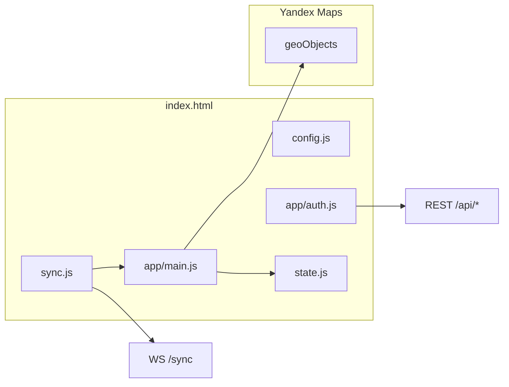

# Клиентская часть (frontend)

Статика в `public/`. Сборка не используется: скрипты подключаются тегами `<script>` в HTML. Глобальные переменные карты объявлены в `js/core/state.js`.

## Порядок загрузки (`index.html`)

Порядок важен: модули ниже по списку могут вызывать функции из модулей выше.

1. `js/core/config.js` — версия, `getApiBase()`
2. `js/app/auth.js` — сессия (до редиректов и API)
3. `js/core/state.js` — `myMap`, `objects`, режимы
4. `js/core/utils.js`, `script-loader.js`, `notifications.js`, `confirm-dialog.js`, `network-status.js`
5. `js/groups.js` — группы кроссов/узлов
6. `js/map/theme.js`, `map-icons.js`, `cable-underground.js`, `regions.js`, `map-perf.js`, `search.js`
7. `js/fiber-cable-config.js`, `map-legend.js`
8. Модули `js/app/*` (persist, sync drag, placement, cables, connection-lines, cross-node-display, …) — см. `index.html`
9. `js/app/main.js` — оркестрация UI / режимов карты
10. `js/sync.js` — WebSocket (после инициализации карты)

Отложенная загрузка (через `script-loader.js`): `js/catalog/device-catalog.js`, `js/history.js`, `js/ui/help.js`, `js/ui/camera-player.js` и др. — см. `MAP_CORE_DEFERRED_SCRIPTS` / `MAP_UI_DEFERRED_SCRIPTS` в `script-loader.js`.

## Другие страницы

| Страница | Ключевые скрипты |
|----------|------------------|
| `auth.html` | `config.js`, `app/auth.js`, cookie-consent, maintenance, support-chat |
| `pricing.html`, `news.html` | `landing-nav.js`, page-bg-plexus, cookie-consent, support-chat |
| `site-admin.html` | `config.js`, `app/auth.js`, `admin/news-editor.js` |

Полный список файлов — [public/js/README.md](../public/js/README.md).

## Архитектура карты

- **Модель данных на клиенте:** массив `objects` — экземпляры `ymaps` (placemark, polyline, polygon) с `properties` (тип, `uniqueId`, связи).
- **Сериализация:** `getSerializedData()` / `saveData()` в `map-persistence.js` (инкрементальный патч при move/add/delete).
- **Группы:** несколько кроссов/узлов в одной точке отображаются одним group-placemark (`updateCrossDisplay` / `updateNodeDisplay`).

## Синхронизация на клиенте

Файл `js/sync.js`:

- Подключение к `/sync`, debounce полного `state` (~400 ms)
- Инкрементальные операции: `syncSendOp` из `main.js` (`add_object`, `update_object`, `delete_*`, …)
- Курсоры: throttle ~120 ms
- Блокировки объектов при редактировании карточки

## Производительность карты

Модуль `js/map/map-perf.js`:

| Механизм | Назначение |
|----------|------------|
| `objectsById` | Поиск объекта по `uniqueId` за O(1) |
| `cablesByObjectUid` | Reverse-индекс «объект → касающиеся кабели» (`getCablesTouchingUid`) |
| `scheduleConnectionLinesUpdate` | Debounce пересборки линий ONU/OLT/сплиттер/узел/радиомост |
| Инкрементальные группы | `updateCrossDisplay(key)` / `updateNodeDisplay(key)` — только затронутая точка |
| Viewport cull | При ≥120 объектах скрытие вне видимой области карты |
| Виртуализация | При ≥400 объектах на карту монтируются в основном объекты viewport |
| Spatial grid | `querySpatialNearCoords` для локальных проверок размещения |
| Линии связи | Не рисуются при zoom &lt; 17 |
| `warmIndexes` | Прогрев индексов после загрузки (до первого редактирования) |

Пакетная загрузка при импорте ≥350 объектов: `MAP_BULK_IMPORT_*` (батчи через `requestAnimationFrame`).

### Размещение vs перемещение

**Размещение** (`object-placement.js` → `create-object.js`) — одноразовое: один placemark, инкрементальный `saveData({ addObject })`, side-effects в `rAF` / idle. На каждый mousemove двигается только phantom-маркер.

**Перемещение** дороже: поток событий `drag` + финализация на `dragend`. На больших картах критично не делать на каждый кадр и в том же тике отпускания тяжёлую работу.

| Фаза | Где | Что допустимо |
|------|-----|----------------|
| `drag` (кадр) | `map-selection.js` → `scheduleDragUpdate` | Только pulse, Alt-path муфты (`applySleevePathDrag`), hover-card. **Не** обновлять кабели и GPON-линии |
| `dragstart` | `create-object.js` / `map-persistence.js` | Прогрев `MapPerf.ensureCableLinksIndex`, `ensureLastSavedUidIndex`; снять label с карты один раз |
| `dragend` | `object-sync.js` → `finalizeMapObjectDragEnd` | Snap группы, `updateConnectedCablesLight`, label/spatial, инкрементальный save+sync |
| Idle после dragend | тот же finalize | Attach опоры (`tryAttachWaypointToNearbyCables`), полный `updateConnectedCables` (overlays), `scheduleConnectionLinesUpdate`, filter |

На картах **>800 объектов** синхронный GPON-nudge и `updateCrossDisplay` / `updateNodeDisplay` на dragend откладываются (nudge/rebuild — в idle, display групп — в следующий `rAF`), чтобы UI не замирал на отпускании.

Групповой drag кроссов/узлов (`cross-node-display.js`): на `dragend` — `updateConnectedCablesLight` + save; полный update кабелей и линий — в `requestIdleCallback`.

### Инкрементальный save / sync при move

| Механизм | Файл | Назначение |
|----------|------|------------|
| `saveData` с `objects` / `object` | `map-persistence.js` | Патч только затронутых `uniqueId` в `lastSavedState`, без полной сериализации карты |
| `_lastSavedUidIndex` | `map-persistence.js` | `uniqueId → revision` для O(1) `snapshotHasUniqueId` / `getSnapshotRevisionFromIndex`; точечное обновление после патча |
| `warmMapEditCaches` | `map-persistence.js` | Idle после load: индексы, при необходимости полный снимок — чтобы первый move не платил O(N) |
| `updateConnectedCablesLight` | `cable-helpers.js` | Только `setCoordinates` по кабелям из reverse-индекса, без recreate underground overlays |
| Индекс GPON-линий | `connection-lines.js` | `ensureConnLinesByUidIndex` — nudge только линий, касающихся uid |
| BBox cull | `cable-routing.js` → `findCablesNearPoint` | Отсев кабелей до `projectPointOntoPolyline` |

Правила при доработках:

- Не возвращать `updateConnectedCables` / `nudgeConnectionLinesDuringDrag` / `syncConnectionLinesForObject` в `scheduleDragUpdate`.
- Для sync baseRevision использовать индекс снимка, не линейный обход `lastSavedState`.
- Предпочитать `scheduleConnectionLinesUpdate(uid)` вместо `updateAllConnectionLines()`.
- Attach опоры к кабелям на dragend всегда откладывать в idle (скан кабелей дорогой).

## Стили

| Файл | Страницы |
|------|----------|
| `css/styles.css` | `index.html` |
| `css/app-mobile.css` | Карта, мобильная вёрстка |
| `css/auth.css` | auth, pricing, news |
| `css/landing.css`, `landing-header.css` | pricing, news |
| `css/site-admin.css` | site-admin |

Тема карты и UI: `js/map/theme.js`, CSS-переменные в `styles.css`.

## Соглашения

- Новые типы объектов: иконки в `js/map/map-icons.js`, фильтр в `main.js` (`applyMapFilter`)
- Уникальный id: `getObjectUniqueId()` + регистрация в `MapPerf.registerMapObject`
- Не вызывать `updateAllConnectionLines()` напрямую без необходимости — предпочтительно `scheduleConnectionLinesUpdate(uid)`
